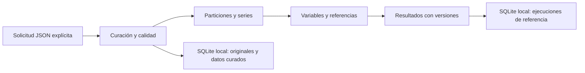

# Diagnóstico y decisiones de arquitectura

Fecha de inspección: 2026-10-21. Trazabilidad: R01/T01.1–T01.3 y R05/T05.1–T05.3.
Este documento distingue código inspeccionado, software ejecutado y solución propuesta.
No certifica un despliegue ni modifica el alcance académico aprobado.

## Evidencia y límites

Actualización del 23 de octubre de 2026: el inventario inicial de abajo es histórico. Ahora existen checkouts locales de centinela-front y predictive-service, un corpus recibido de 28100 artículos para desarrollo, preparación reproducible y un explorador Angular con diagnóstico de calidad. La [inspección del predictor](predictor-heredado.md) y la [preparación versionada](calidad-preparacion.md) registran ese avance. Siguen pendientes Lakehouse, acceso operacional a Neo4j/MongoDB, modelos propios, XAI e integración real de identidad/gateway. El permiso de desarrollo y las fechas recibidas no acreditan viabilidad para una evaluación predictiva final.

- Código local: `app/`, requisitos fijados, configuración de ejecución y CI existente de analytics-service.
- Ejecución local: pruebas automatizadas, inventario AST, manifiesto del entorno y exportación OpenAPI.
- Fuentes externas: archivos públicos de la rama `develop` indicados abajo. Son referencias móviles: conservar su revisión exacta antes de implementar cambios entre repositorios.
- No se comprobó conectividad con servicios desplegados, Neo4j, MongoDB, almacenamiento de objetos o identidad. No se obtuvo corpus ni se entrenaron modelos propios.
- El plan `F_AA_234A_Jairo_Quispe.pdf`, pp. 1–3, exige Data Lakehouse, ETL/ELT, modelado temático, pronóstico, XAI e integración visual. SQLite local no satisface por sí solo esa infraestructura.
- OE6 conserva evaluación con usuarios reales; la exclusión de participantes está documentada como CR01 propuesta. Este diagnóstico no constituye aprobación académica de ese cambio.

## Componentes comprobados por inspección

| Componente | Responsabilidad observada | Fuente y tipo de evidencia | Pendiente |
|---|---|---|---|
| analytics-service | Curación, particiones, series desde asignaciones, variables históricas, referencias y artefactos locales | Código local y ejecución técnica | Corpus, modelos definitivos, XAI, fuente externa y almacenamiento Lakehouse |
| centinela-front | SPA Angular; configuración de rutas relativas al gateway | [package.json](https://github.com/PlataformaIntegradaInvestigadores/centinela-front/blob/develop/package.json), [environment.ts](https://github.com/PlataformaIntegradaInvestigadores/centinela-front/blob/develop/src/environments/environment.ts) | La configuración consultada no declara `apiAnalytics`; implementar en el frontend existente |
| gateway-service | Nginx dirige `/api/analytics/` hacia `/api/v1/` del servicio analítico, puerto 8006 | [nginx.conf](https://github.com/PlataformaIntegradaInvestigadores/gateway-service/blob/develop/nginx.conf) | Verificación real de red, identidad y publicación del esquema analítico en el hub de documentación |
| search-service | Backend Django sobre Neo4j y MongoDB | [README](https://github.com/PlataformaIntegradaInvestigadores/search-service/blob/develop/README.md) | Acceso autorizado y comprobación de cobertura, campos y consultas |
| Artículo en search-service | Entidad con Scopus ID, título, resumen, DOI, fecha y relaciones temáticas | [article.py](https://github.com/PlataformaIntegradaInvestigadores/search-service/blob/develop/apps/search_engine/domain/entities/article.py) | Distinguir palabras clave heredadas de temas inferidos por el modelo propio |
| search-bff-service | Contrato v2 y adaptación HTTP de search-service; sin BD propia | [README](https://github.com/PlataformaIntegradaInvestigadores/search-bff-service/blob/develop/README.md) | No asumir que búsquedas paginadas equivalen a una exportación íntegra del corpus |
| predictive-service | Predictor heredado de publicaciones por afiliación y recursos de preprocesamiento | [README](https://github.com/PlataformaIntegradaInvestigadores/predictive-service/blob/develop/README.md) | Verificar artefactos; su tarea no equivale al pronóstico temático de esta tesis |

El gateway declara un subendpoint interno de validación de identidad, pero en el archivo consultado no aparece una directiva `auth_request` que lo aplique a analytics. No se presume protección por su sola declaración. Los POST analíticos actuales se mantienen restringidos al entorno `local` hasta concretar la integración de identidad.

## Flujo actual y flujo objetivo

El flujo actual procesa lotes proporcionados; no extrae datos de servicios externos.

```mermaid
flowchart LR
    N[Neo4j y MongoDB existentes] --> S[search-service / exportación autorizada]
    S --> R[Zona original: metadatos y textos autorizados]
    R --> C[Tablas curadas, calidad y linaje]
    C --> T[Particiones temporales y modelos temáticos]
    T --> P[Series, entrenamiento y pronóstico]
    P --> X[Atribuciones XAI compatibles]
    X --> O[Resultados versionados]
    O --> API[analytics-service]
    API --> GW[gateway-service]
    GW --> UI[Dashboard en centinela-front]
```

Este segundo diagrama es el diseño objetivo, no un flujo ya desplegado. Neo4j permanece en su responsabilidad operacional existente; no se recrean grafos de coautoría ni se duplican responsabilidades excluidas del PMV.

## Decisiones y comparación de almacenamiento

| Opción | Uso apropiado en este proyecto | Consistencia y versiones | Decisión |
|---|---|---|---|
| SQLite | Pruebas locales, lotes y artefactos de referencia con transacciones | Escritura atómica, contenido identificado por SHA-256 y restauración de solo lectura | Implementado como apoyo local; no se presenta como Lakehouse |
| Neo4j existente | Consulta del dominio y relaciones ya gestionadas por search-service | Depende de la política del sistema de origen; registrar identificadores y fecha de extracción | Reutilizar mediante acceso autorizado; no crear un grafo paralelo |
| MongoDB existente | Datos y salidas ya administrados por search-service | Exigir esquema/exportación, procedencia y cobertura comprobables | Fuente existente; no elegirlo automáticamente como almacén analítico final |
| Objetos/archivos abiertos con capa de tablas transaccionales | Textos originales y tablas analíticas bajo el enfoque Lakehouse del plan | Requiere catálogo, transacciones, versiones y asociación a cada experimento | Obligación arquitectónica pendiente; seleccionar formato/motor con infraestructura y recursos reales |

No se declara implementado Delta Lake, Iceberg, Parquet transaccional ni almacenamiento de objetos. La decisión de formato queda abierta hasta comprobar dónde se desplegará y qué recursos están habilitados; un directorio de JSON no se denominará Lakehouse.

## Contratos y límites de responsabilidad

- Fuente: identificador estable, origen, fecha de recuperación, DOI opcional, fecha de publicación completa o desconocida, resumen/texto accesible y evidencia de permisos. No inventar fechas de primera disponibilidad.
- Datos curados: documento canónico, procedencia, versión, faltantes, rechazos y conciliación de conteos. Las entradas parciales se declaran expresamente.
- Modelo temático: configuración y versión, documentos asignados, rechazados/no asignados y términos representativos. Las keywords del origen no acreditan inferencia temática.
- Serie: tema y versión de definición, periodo, unidad, denominador y cobertura. La cobertura declarada no implica verificación independiente del corpus.
- Predictor: historial disponible al corte, horizonte, modelo y datos identificados. La reserva final no interviene en selección de modelos.
- XAI: asociar atribuciones con la predicción y sus entradas reales; evaluar fidelidad y estabilidad. Términos temáticos no sustituyen atribuciones predictivas.
- API/UI: rutas relativas vía gateway, errores documentados y distinción de observación/proyección/ausencia. Acceso protegido e integración real pendientes.

## Condiciones para pasar a integración

1. Confirmar acceso de escritura por repositorio y procedimiento de revisión; conservar ramas desde develop y PR hacia develop.
2. Obtener exportación o consulta autorizada, diccionario de campos y cobertura temporal.
3. Determinar si la extracción será por exportación o API. Validar paginación y completitud, sin recorrer automáticamente endpoints de búsqueda como si fueran una exportación.
4. Confirmar infraestructura y formato de las tablas Lakehouse. Medir recursos reales antes de elegir motores pesados.
5. Resolver identidad, autorización y publicación del esquema, manteniendo la restricción local hasta comprobarlas.
6. Ejecutar integración con los servicios reales. La inspección de código y los tests locales no acreditan ese paso.
